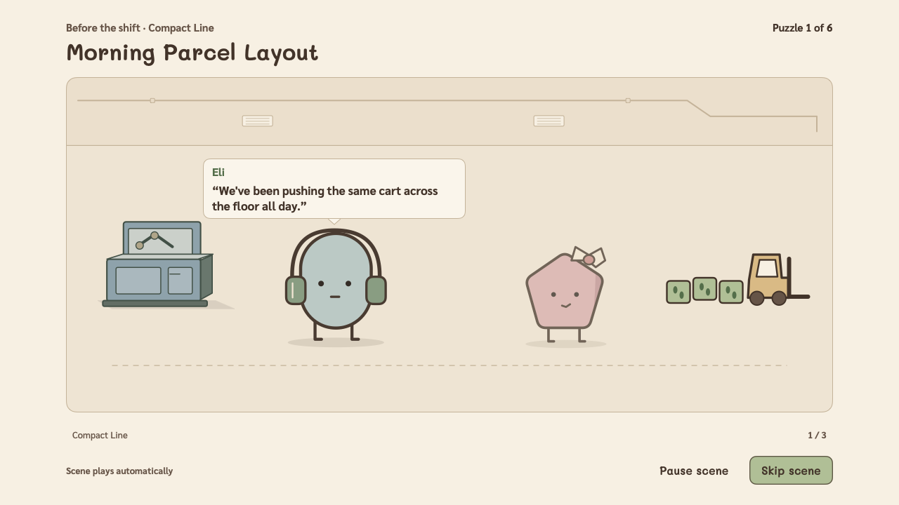

# Does This Work?

**English** · [ไทย](README.th.md)

The wrapping station is slowing down the line. The crew has different skills, and moving one person might leave another station short. Who would you move?

**Does This Work?** is an open-source, offline puzzle game about industrial engineering. It has 360 puzzles across four stages, with six puzzles per run and no countdown.

## The four stages

| Stage | What you control |
| --- | --- |
| **Staff the Stations** | Match workers to open slots while meeting station targets and crew rules. |
| **Find the Bottleneck** | Move workers to increase the finished output of the entire line. |
| **Plan the Plant** | Place machines to shorten cart trips and keep aisles clear. |
| **Plan the Delivery Route** | Order stops to meet distance or delivery windows, including the trip back to the depot. |

Before each puzzle, the crew talks through the problem. Once you have a plan, the checkmark turns green when every requirement is met.

## Play

The v0.6 Beta downloads will appear on [GitHub Releases](../../releases). You can build from source below.

| Platform | Open after extracting the ZIP |
| --- | --- |
| macOS 14+ on Apple Silicon | `Does This Work?.app` |
| Windows 64-bit on Intel/AMD | `Does This Work.exe` |

In the game, choose **Settings → Language** to switch between English and Thai. The Windows puzzle engine was checked against all 360 reference solutions, and the macOS bundle signature was verified. Desktop launch and playthrough testing of the packaged beta is pending.

## Build from source

- **macOS.** With Xcode selected, run `cd macOS && bash Scripts/build.sh`. The app appears under `macOS/outputs/`. [macOS build and test instructions](macOS/README.md)
- **Windows.** With Node.js and Python 3.11 or later, run `cd Windows && node qa/test.mjs` for puzzle checks. The packaging script uses a verified Electron runtime archive. [Windows build instructions](Windows/README.md)

## Licenses and feedback

Game code and build scripts use the [MIT License](LICENSE). Original art, audio, dialogue, and puzzles use [CC BY 4.0](ASSETS-LICENSE.md). Mali and Sarabun use the SIL Open Font License 1.1. The Windows distribution includes Electron's third-party notices.

Open an [issue](../../issues) for bugs or puzzle feedback. Include your game version, operating system, and puzzle title.
