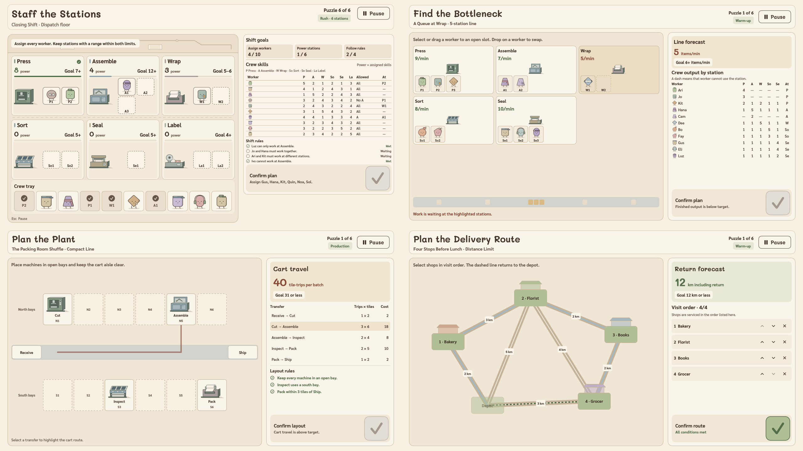
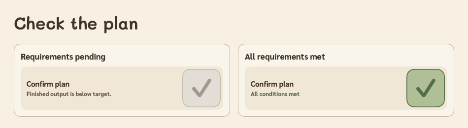

# Does This Work?

**English** · [ไทย](README.th.md)

The wrapping station is slowing down the line. The crew has different skills, and moving one person might leave another station short. Who would you move?

**Does This Work?** is an open-source, offline puzzle game about industrial engineering. It has 360 puzzles across four stages, with six puzzles per run and no countdown.

## The four stages

### 1. Staff the Stations — Constrained assignment

Every worker needs one eligible slot. A worker's rating depends on the station, and the ratings of everyone at a station add up to its power. A station can have a minimum or a permitted range. Crew rules add constraints such as requiring two people to work together or at separate stations. Start with the workers who have the fewest eligible slots, then use the people with more options to cover the remaining gaps. [Assignment with constraints · OR-Tools](https://developers.google.com/optimization/assignment/assignment_teams)

**Example from the board above.** Wrap has 3 power and needs 5–6. An eligible worker who adds 2 or 3 power fits the range. A worker who adds 4 would put Wrap over its limit.

### 2. Find the Bottleneck — Capacity and throughput

Every finished item passes through the stations in order. The game forecasts the line's finished output as the lowest station capacity. Move or swap workers to raise that minimum while keeping enough capacity at the station they leave. After a move, check the whole line again because a different station can become the bottleneck. [Capacity planning and production flow · MIT OpenCourseWare](https://ocw.mit.edu/courses/15-772j-d-lab-supply-chains-fall-2014/1dd429bbbdc60f253a127439dada6ef2_MIT15_772JF14_Lec06.pdf)

**Example from the board above.** Station capacities are 9, 7, 5, 8, and 10 items per minute. The line makes 5. To reach the target of 6, Wrap must reach at least 6 and every other station must stay at or above 6.

### 3. Plan the Plant — Load-distance analysis

Place machines in open bays around the aisle. For each material transfer, multiply the number of cart trips per batch by the distance the cart travels through the aisle. Add those products to get total cart travel in tile-trips per batch. Frequent transfers offer more savings per tile shortened. A layout can also have fixed machines or require a station to be near shipping. [Facility layout evaluation · University of Texas at Austin](https://utw11041.utweb.utexas.edu/ORMM/omie/design/unit/layout/evaluation.html)

**Example from the board above.** Cut → Assemble takes 3 trips over 6 tiles each, so it contributes 18 of the current 40 tile-trips. Shortening that leg by one tile saves 3 tile-trips if the other distances stay the same. The target for the whole layout is 31 or less, so check every leg affected when you move a machine.

### 4. Plan the Delivery Route — Routing and time windows

Choose the order in which to serve the shops. The game calculates the roads between consecutive stops and includes the return to the depot. Some puzzles set a distance budget. Others use time, so waiting and unloading count. In the shop-window mode, you can arrive early and wait, but unloading must finish by closing. In the traffic mode, travel time can change based on when you enter a road. [Vehicle routing with time windows · OR-Tools](https://developers.google.com/optimization/routing/vrptw)

**Example.** If you arrive at 09:50, the shop opens at 10:00, and unloading takes five minutes, the visit ends at 10:05. That works if the shop closes at 10:05 or later. You still have to account for the remaining stops and the drive back.

The crew introduces the problem before each puzzle. The checkmark turns green when your plan meets every condition. Different plans can pass if they all meet the requirements.

## Play

See [GitHub Releases](../../releases) for current downloads. The two archived builds below run on macOS 14 or later on Apple Silicon. Extract the ZIP and open the app inside.

| Release | What's included |
| --- | --- |
| [v0.2](https://github.com/J4olahmXDev/does-this-work/releases/tag/v0.2) | The expanded staffing stage with 90 puzzles. |
| [v0.1.0 Demo](https://github.com/J4olahmXDev/does-this-work/releases/tag/v0.1.0) | The original English-language demo, released as IE Puzzle Game, with 30 staffing puzzles. |

The screenshots above show the v0.6 development version, which you can build from source for macOS or Windows. In that version, choose **Settings → Language** to switch between English and Thai. The Windows puzzle engine was checked against all 360 reference solutions, and the macOS bundle signature was verified. Desktop launch and playthrough testing of the v0.6 packages is pending.

## Build from source

- **macOS.** With Xcode selected, run `cd macOS && bash Scripts/build.sh`. The app appears under `macOS/outputs/`. [macOS build and test instructions](macOS/README.md)
- **Windows.** With Node.js and Python 3.11 or later, run `cd Windows && node qa/test.mjs` for puzzle checks. The packaging script uses a verified Electron runtime archive. [Windows build instructions](Windows/README.md)

## Licenses and feedback

Game code and build scripts use the [MIT License](LICENSE). Original art, audio, dialogue, and puzzles use [CC BY 4.0](ASSETS-LICENSE.md). Mali and Sarabun use the SIL Open Font License 1.1. The Windows distribution includes Electron's third-party notices.

Open an [issue](../../issues) for bugs or puzzle feedback. Include your game version, operating system, and puzzle title.
