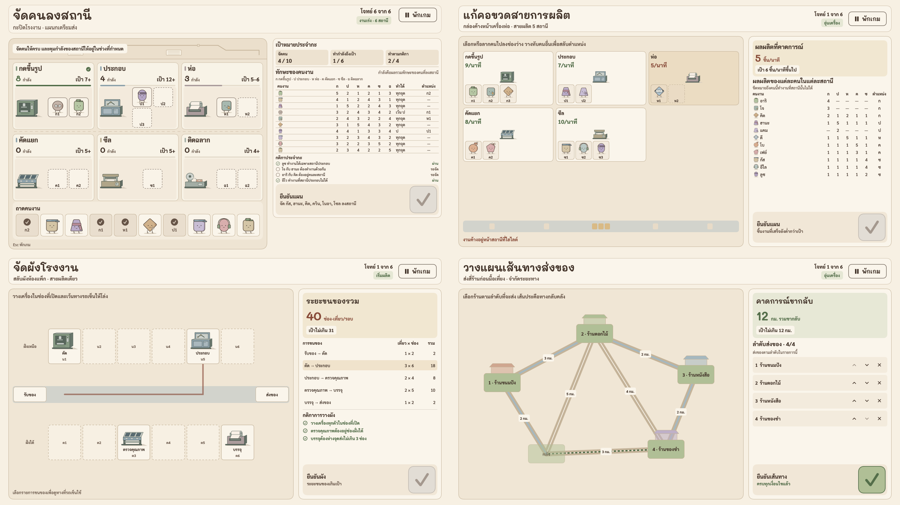
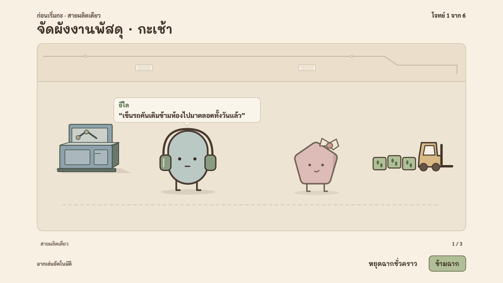
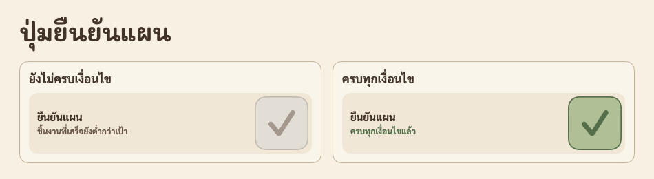

# Does This Work?

[English](README.md) · **ไทย**

สถานีห่อของทำให้ทั้งสายผลิตช้าลง คนงานแต่ละคนถนัดคนละอย่าง ถ้าย้ายผิดคน สถานีอื่นก็อาจขาดคนแทน คุณจะย้ายใครดี?

**Does This Work?** คือเกมพัซเซิลวิศวกรรมอุตสาหการแบบออฟไลน์และโอเพนซอร์ส มี 360 โจทย์ใน 4 สเตจ เล่นรอบละ 6 โจทย์โดยไม่จับเวลา

## สี่สเตจ

### 1. จัดคนลงสถานี — การมอบหมายงานภายใต้ข้อจำกัด

คนงานแต่ละคนต้องได้หนึ่งช่องที่ลงได้ คะแนนทักษะของคนเดียวกันอาจต่างกันตามสถานี และกำลังของสถานีคือผลรวมคะแนนของคนที่ประจำอยู่ สถานีอาจกำหนดขั้นต่ำหรือกำหนดเป็นช่วง ส่วนกติกาของทีมอาจให้บางคนทำงานด้วยกันหรืออยู่คนละสถานี ลองจัดคนที่มีทางเลือกน้อยก่อน แล้วใช้คนที่ลงได้หลายจุดเติมตรงที่ยังขาด [การมอบหมายงานภายใต้ข้อจำกัด · OR-Tools](https://developers.google.com/optimization/assignment/assignment_teams)

**ตัวอย่างจากภาพด้านบน** สถานีห่อมีกำลัง 3 หน่วย และต้องอยู่ในช่วง 5–6 หน่วย เลือกคนที่ลงสถานีนี้ได้และเพิ่มกำลัง 2 หรือ 3 หน่วยก็จะถึงเป้า ถ้าเพิ่ม 4 กำลังรวมจะเกินเพดาน

### 2. แก้คอขวดสายการผลิต — กำลังผลิตและผลผลิตทั้งสาย

ชิ้นงานต้องผ่านทุกสถานีตามลำดับ เกมจึงใช้กำลังผลิตของสถานีที่ต่ำที่สุดเป็นจำนวนชิ้นงานที่ทั้งสายทำเสร็จต่อนาที ลองย้ายหรือสลับคนเพื่อเพิ่มกำลังตรงคอขวด แล้วเช็กว่าสถานีที่เสียคนไปยังมีกำลังพอ ย้ายเสร็จแล้วให้ดูทั้งสายอีกครั้ง เพราะคอขวดอาจย้ายไปอยู่ที่สถานีอื่น [การวางแผนกำลังผลิต · MIT OpenCourseWare](https://ocw.mit.edu/courses/15-772j-d-lab-supply-chains-fall-2014/1dd429bbbdc60f253a127439dada6ef2_MIT15_772JF14_Lec06.pdf)

**ตัวอย่างจากภาพด้านบน** แต่ละสถานีทำได้ 9, 7, 5, 8 และ 10 ชิ้นต่อนาที ทั้งสายจึงเสร็จ 5 ชิ้นต่อนาที ถ้าเป้าคือ 6 ต้องดันสถานีห่อให้ได้อย่างน้อย 6 และรักษาสถานีอื่นให้อยู่ที่ 6 ขึ้นไปด้วย

### 3. จัดผังโรงงาน — การวิเคราะห์ระยะขนย้ายแบบถ่วงน้ำหนัก

วางเครื่องจักรลงในช่องว่างริมทางเดิน สำหรับการขนย้ายแต่ละคู่ ให้เอาจำนวนเที่ยวต่อรอบคูณระยะทางที่รถเข็นวิ่งผ่านทางเดิน แล้วบวกทุกคู่เป็นระยะขนของรวม หน่วยในเกมคือช่อง-เที่ยวต่อรอบ การลดทางหนึ่งช่องในเส้นทางที่ใช้บ่อยจะช่วยมากกว่าในเส้นทางที่ใช้น้อย บางโจทย์ยังล็อกเครื่องจักรไว้หรือกำหนดให้บางสถานีอยู่ใกล้จุดส่งของ [การประเมินผังโรงงาน · University of Texas at Austin](https://utw11041.utweb.utexas.edu/ORMM/omie/design/unit/layout/evaluation.html)

**ตัวอย่างจากภาพด้านบน** รถเข็นจากสถานีตัดไปประกอบวิ่ง 3 เที่ยว เที่ยวละ 6 ช่อง คิดเป็น 18 จากทั้งหมด 40 ช่อง-เที่ยว ถ้าลดเส้นทางนี้ได้หนึ่งช่องจะประหยัด 3 ช่อง-เที่ยวเมื่อระยะทางคู่อื่นเท่าเดิม เป้าของทั้งผังคือไม่เกิน 31 จึงต้องเช็กเส้นทางอื่นที่เปลี่ยนด้วยทุกครั้งที่ย้ายเครื่อง

### 4. วางแผนเส้นทางส่งของ — การจัดเส้นทางและช่วงเวลารับของ

เลือกว่าจะส่งร้านไหนก่อน เกมคำนวณเส้นทางระหว่างจุดส่งและนับขากลับคลังด้วย บางโจทย์จำกัดระยะทาง บางโจทย์คิดเวลาเดินทาง เวลารอ และเวลาขนของลง ถ้าเป็นโหมดเวลารับของ ไปถึงก่อนเปิดร้านแล้วรอได้ แต่ต้องขนของเสร็จไม่เกินเวลาปิด ส่วนโหมดจราจรจะคิดเวลาเดินทางตามเวลาที่รถเข้าถนนแต่ละเส้น [การจัดเส้นทางแบบมีช่วงเวลา · OR-Tools](https://developers.google.com/optimization/routing/vrptw)

**ตัวอย่าง** ไปถึง 09:50 ร้านเปิด 10:00 และใช้เวลาขนของลง 5 นาที จะเสร็จตอน 10:05 แผนนี้ทันถ้าร้านปิดตั้งแต่ 10:05 เป็นต้นไป จากนั้นยังต้องเผื่อเวลาให้จุดส่งที่เหลือและขากลับคลังด้วย

คนงานจะคุยกันก่อนเริ่มโจทย์ พอแผนครบทุกเงื่อนไข ปุ่ม ✓ จะเปลี่ยนเป็นสีเขียว แต่ละโจทย์อาจมีหลายแผนที่ผ่านได้ค่ะ

## เล่นเกม

ไฟล์ดาวน์โหลด v0.6 Beta จะอยู่ที่ [GitHub Releases](../../releases) ระหว่างนี้บิลด์เกมเองได้ตามขั้นตอนด้านล่าง

| ระบบ | เปิดไฟล์นี้หลังแตก ZIP |
| --- | --- |
| macOS 14 ขึ้นไปบน Apple Silicon | `Does This Work?.app` |
| Windows 64 บิตบน Intel/AMD | `Does This Work.exe` |

ในเกมเลือก **Settings → Language → ไทย** เพื่อเปลี่ยนภาษา ตัวตรวจคำตอบของ Windows ผ่านการเทียบครบ 360 โจทย์ และตรวจลายเซ็นแอป macOS แล้ว ชุด Beta ยังรอทดสอบการเปิดแอปและเล่นจริงจากไฟล์ที่แพ็กไว้

## บิลด์จากซอร์ส

- **macOS** เลือก Xcode เป็นเครื่องมือบิลด์ แล้วรัน `cd macOS && bash Scripts/build.sh` แอปจะอยู่ใน `macOS/outputs/` [วิธีบิลด์และทดสอบบน macOS](macOS/README.md)
- **Windows** ใช้ Node.js และ Python 3.11 ขึ้นไป รัน `cd Windows && node qa/test.mjs` เพื่อตรวจโจทย์ สคริปต์แพ็กเกมใช้ ZIP ของ Electron ที่ตรวจสอบแล้ว [วิธีบิลด์สำหรับ Windows](Windows/README.md)

## สัญญาอนุญาตและแจ้งปัญหา

โค้ดและสคริปต์บิลด์ใช้ [MIT](LICENSE) งานภาพ เสียง บทสนทนา และโจทย์ต้นฉบับใช้ [CC BY 4.0](ASSETS-LICENSE.md) ฟอนต์ Mali และ Sarabun ใช้ SIL Open Font License 1.1 และชุดเกม Windows มีประกาศสิทธิ์ของ Electron แนบมาด้วย

ถ้าเจอบั๊กหรืออยากให้ปรับโจทย์ เปิด [Issue](../../issues) พร้อมระบุเวอร์ชันเกม ระบบปฏิบัติการ และชื่อโจทย์ได้เลย
